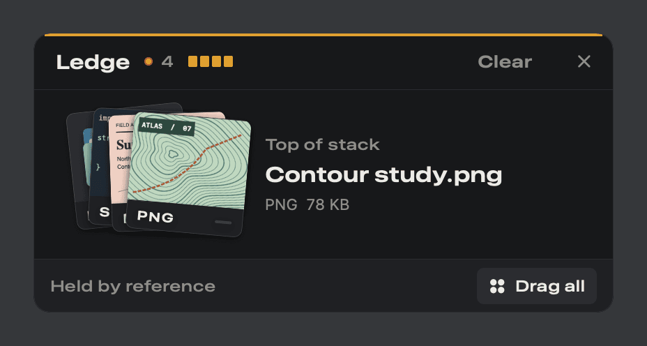

# Ledge

A free drag-and-drop shelf for macOS. Drop files, switch apps or Spaces, drag them out.

<p align="center"></p>

<p align="center">    </p>

Requires macOS 15 or later.

## What it does
- Opens when you shake a file while dragging, hold a drag at a screen edge (optional), press a shortcut, or use the menu bar icon. Dropping files onto the menu bar icon starts a new shelf with them.
- Files stay where they are; the shelf only points to them.
- Dropped text, images and links are saved as files. Web images keep their original file and bytes.
- Mail attachments and Photos drops work.
- Items that were moved or deleted are removed from the shelf with a quiet note.
- Drag one item or the whole stack out. Option-drag keeps it on the shelf.
- Dropping something already on the shelf says so. With the pointer over an item, Delete removes it and Return opens it.
- Right-click for Quick Look, Copy, Reveal in Finder, Share or Remove.
- Quick actions for the shelf: AirDrop, Zip (an `Archive.zip` beside the originals) and Copy path.

## Keyboard
| Action | Shortcut |
|---|---|
| Open a shelf | ⌃⌥L (changeable) |
| Settings | ⌘, |

## Install

**Homebrew**

```
brew tap noterikkirillov8/tap
brew trust noterikkirillov8/tap
brew install --cask ledge
```

**Download**: get `Ledge-1.0.0.zip` from [Releases](https://github.com/noterikkirillov8/ledge/releases), unzip it and drag `Ledge.app` to Applications.

**Build from source**: see below.

Ledge isn't notarised by Apple (that needs a paid developer account), so the first time macOS may say it can't verify the developer: open System Settings → Privacy & Security, scroll down and click Open Anyway (on macOS 15 and later right-click → Open no longer works). The Homebrew cask clears that flag for you.

## How it works
The shelf stores references to the files you drop. Dropped text, images and links are saved in `~/Library/Application Support/Ledge/Items` and cleaned up after a retention time you choose (1 to 90 days, default 7). The shake gesture is read from global mouse events, which needs no permission. Zip runs `ditto` on a temporary copy and never changes the originals. An optional setting hands copies of newly landed images to a compatible optimiser app, if one is installed; the copies go to a cache folder, results land beside the originals, and the originals are never edited. It is off by default.

## Privacy
No network, no telemetry, no permissions. Shelves and their items survive restarts and live on your Mac only.

## Build from source
Needs Xcode 16+ and [XcodeGen](https://github.com/yonaskolb/XcodeGen).

```
scripts/test.sh                  # tests
NO_OPEN=1 scripts/install.sh      # build Release and install to /Applications
```
`scripts/install.sh` signs with the author's local certificate if you have it, and ad hoc otherwise, so it works on any Mac.

## Credits
MIT licence. Interface sounds by Kenney (kenney.nl), CC0.

---
Part of Patchbay: [Harbor](https://github.com/noterikkirillov8/harbor) / [Tally](https://github.com/noterikkirillov8/tally) / [Sweep](https://github.com/noterikkirillov8/sweep) / [Ledge](https://github.com/noterikkirillov8/ledge) / [Switchboard](https://github.com/noterikkirillov8/switchboard) / [Shutter](https://github.com/noterikkirillov8/shutter) / [Reel](https://github.com/noterikkirillov8/reel) / [Vigil](https://github.com/noterikkirillov8/vigil)
